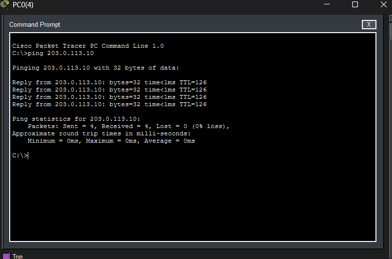
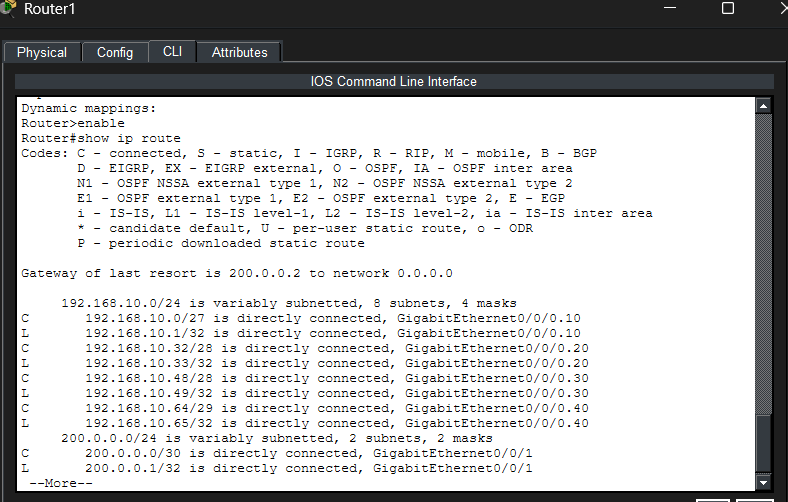
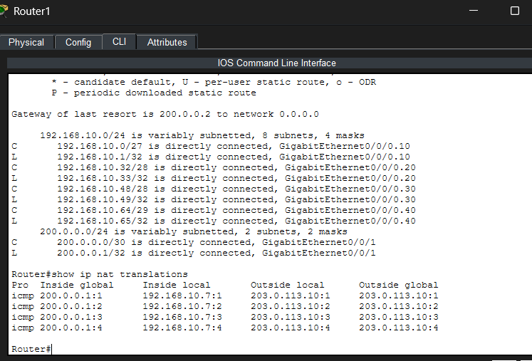
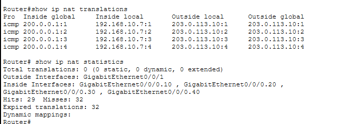

# 🌐 Rede Corporativa — Alfa Engenharia


## 📖 Sobre o projeto

Este projeto apresenta o planejamento, a implementação e a validação de uma infraestrutura de rede corporativa simulada para a empresa fictícia **Alfa Engenharia**, utilizando o Cisco Packet Tracer.

A proposta é desenvolver uma rede segmentada, organizada e escalável, aplicando conceitos fundamentais de infraestrutura e administração de redes.

A implementação contempla:

- Planejamento de endereçamento IPv4 utilizando VLSM;
- Segmentação da rede por departamentos utilizando VLANs;
- Configuração de enlaces trunk com IEEE 802.1Q;
- Roteamento inter-VLAN utilizando Router-on-a-Stick;
- Distribuição automática de endereços IP com DHCP;
- Configuração de DHCP Relay;
- Controle de tráfego entre departamentos utilizando ACLs;
- Conexão da rede interna com um ISP simulado;
- Configuração de rota padrão;
- Tradução de endereços utilizando NAT/PAT;
- Testes de conectividade e diagnóstico de rede.

O laboratório faz parte dos meus estudos práticos em **Redes de Computadores, Infraestrutura de TI e DevOps**.

---

## 🎯 Objetivos

O principal objetivo é simular uma infraestrutura de rede empresarial que permita compreender como diferentes tecnologias trabalham em conjunto para garantir comunicação, organização e controle de acesso.

### Objetivos específicos

1. Planejar um esquema de endereçamento IP eficiente.
2. Segmentar a rede por departamentos.
3. Permitir comunicação entre VLANs por meio de roteamento.
4. Centralizar a distribuição de endereços IP.
5. Aplicar políticas de controle de acesso entre setores.
6. Simular a comunicação entre uma rede privada e uma rede externa.
7. Implementar tradução de endereços IPv4 com NAT/PAT.
8. Validar as configurações por meio de comandos de diagnóstico.

---

## 🏗️ Arquitetura da rede

A infraestrutura foi organizada em uma topologia hierárquica, utilizando um roteador principal, um switch central e switches de acesso para os departamentos.

### Topologia lógica simplificada

```text
                  REDE EXTERNA
                 Servidor Externo
                  203.0.113.10
                        |
                   ROTEADOR ISP
                   200.0.0.2/30
                        |
                 LINK WAN SIMULADO
                  200.0.0.0/30
                        |
                   ROTEADOR ALFA
                   200.0.0.1/30
                        |
                Router-on-a-Stick
                        |
                    SW-CENTRAL
                        |
        +---------------+---------------+
        |               |               |
      SW-ADM          SW-FIN          SW-TI
        |               |               |
     VLAN 10         VLAN 20         VLAN 30
  Administrativo    Financeiro       TI

                        |
                  SW-RECURSOS
                        |
                     VLAN 40
                        |
                +-------+-------+
                |               |
          Servidor DHCP     Impressora
          192.168.10.66     192.168.10.67
```

O switch central concentra as conexões dos departamentos e estabelece a comunicação com o roteador principal por meio de um enlace trunk.

O roteador Alfa realiza o roteamento entre as VLANs e encaminha o tráfego destinado à rede externa.

---

## 📐 Planejamento de endereçamento IP

A rede utiliza o bloco privado:

`192.168.10.0/24`

Foi aplicada a técnica **VLSM (Variable Length Subnet Mask)** para dividir a rede em sub-redes de tamanhos diferentes, considerando as necessidades de cada departamento.

### Tabela de VLANs

| VLAN | Departamento | Rede | Máscara | Gateway |
|---|---|---|---|---|
| 10 | Administrativo | 192.168.10.0/27 | 255.255.255.224 | 192.168.10.1 |
| 20 | Financeiro | 192.168.10.32/28 | 255.255.255.240 | 192.168.10.33 |
| 30 | TI | 192.168.10.48/28 | 255.255.255.240 | 192.168.10.49 |
| 40 | Recursos | 192.168.10.64/29 | 255.255.255.248 | 192.168.10.65 |

### Capacidade das sub-redes

| VLAN | Hosts utilizáveis | Intervalo de hosts |
|---|---|---|
| 10 | 30 | 192.168.10.1 – 192.168.10.30 |
| 20 | 14 | 192.168.10.33 – 192.168.10.46 |
| 30 | 14 | 192.168.10.49 – 192.168.10.62 |
| 40 | 6 | 192.168.10.65 – 192.168.10.70 |

### Por que utilizar VLSM?

O VLSM permite dimensionar cada sub-rede de acordo com a quantidade de dispositivos necessários.

Isso evita a distribuição de blocos desnecessariamente grandes e melhora o aproveitamento dos endereços IPv4.

---

## 🔀 Segmentação com VLANs

As VLANs permitem dividir logicamente uma infraestrutura física em diferentes domínios de broadcast.

Neste projeto, cada departamento possui sua própria VLAN.

### Benefícios

- Organização do tráfego;
- Redução dos domínios de broadcast;
- Isolamento lógico entre setores;
- Facilidade de administração;
- Possibilidade de aplicar políticas de segurança entre departamentos.

### Comandos de verificação

```cisco
show vlan brief
```

Exibe as VLANs configuradas e as portas associadas.

```cisco
show interfaces trunk
```

Permite verificar quais interfaces estão operando como trunk e quais VLANs são transportadas.

---

## 🔄 Roteamento inter-VLAN

Como dispositivos em VLANs distintas pertencem a redes diferentes, é necessário utilizar um equipamento de camada 3 para permitir a comunicação entre elas.

Neste projeto, foi utilizada a arquitetura **Router-on-a-Stick**.

O roteador possui subinterfaces lógicas associadas às VLANs, utilizando encapsulamento IEEE 802.1Q.

### Organização das subinterfaces

| Subinterface | VLAN | Gateway |
|---|---|---|
| GigabitEthernet0/0/0.10 | 10 | 192.168.10.1 |
| GigabitEthernet0/0/0.20 | 20 | 192.168.10.33 |
| GigabitEthernet0/0/0.30 | 30 | 192.168.10.49 |
| GigabitEthernet0/0/0.40 | 40 | 192.168.10.65 |

### Exemplo de configuração

```cisco
interface GigabitEthernet0/0/0.10
 encapsulation dot1Q 10
 ip address 192.168.10.1 255.255.255.224
```

As demais subinterfaces seguem a mesma lógica, utilizando seus respectivos identificadores de VLAN, máscaras e gateways.

### Verificação

```cisco
show ip interface brief
```

O comando permite consultar os endereços IP e os estados das interfaces.

Também foram utilizados testes de conectividade entre hosts e seus respectivos gateways.

---

## 🖥️ Servidor DHCP centralizado

O projeto utiliza um servidor DHCP localizado na VLAN 40.

**Endereço do servidor:** `192.168.10.66`

A centralização do DHCP facilita o gerenciamento dos endereços distribuídos para os diferentes setores.

### DHCP Relay

Como as mensagens DHCP Discover são inicialmente enviadas em broadcast, elas não atravessam roteadores diretamente.

Para permitir que clientes de outras VLANs utilizem o servidor centralizado, foi configurado o recurso DHCP Relay.

Exemplo:

```cisco
interface GigabitEthernet0/0/0.10
 ip helper-address 192.168.10.66
```

O mesmo princípio é aplicado às demais VLANs que precisam encaminhar requisições ao servidor DHCP.

### Funcionamento

1. O cliente solicita uma configuração IP.
2. A requisição chega à interface de sua VLAN.
3. O roteador encaminha a solicitação ao servidor DHCP.
4. O servidor disponibiliza uma configuração válida.
5. O cliente recebe IP, máscara, gateway e demais parâmetros configurados.

---

## 🔐 Controle de acesso com ACLs

Foram utilizadas listas de controle de acesso (ACLs) para implementar restrições de comunicação entre departamentos.

O objetivo é impedir comunicações não autorizadas e permitir apenas o tráfego compatível com as políticas definidas para a rede.

### ACLs utilizadas

- `CL_ADM` — controle de acesso relacionado ao setor Administrativo;
- `CL_FIN` — controle de acesso relacionado ao setor Financeiro.

As ACLs são avaliadas pelo roteador e permitem filtrar pacotes de acordo com critérios como endereços IP, protocolos e destinos.

### Verificação das ACLs

```cisco
show access-lists
```

Esse comando permite visualizar as regras e seus contadores de correspondência.

```cisco
show running-config
```

Permite conferir as ACLs configuradas e as interfaces em que foram aplicadas.

A política detalhada de permissões e bloqueios deve ser conferida nas configurações do arquivo Packet Tracer, evitando documentar regras diferentes das implementadas.

---

## 🌍 Conexão com a rede externa

Para simular o acesso à internet, foi adicionado um roteador ISP conectado ao roteador principal da empresa.

### Endereçamento WAN

| Dispositivo | Endereço IPv4 |
|---|---|
| Roteador Alfa | 200.0.0.1/30 |
| Roteador ISP | 200.0.0.2/30 |
| Rede WAN | 200.0.0.0/30 |
| Servidor externo simulado | 203.0.113.10 |

Os endereços representam um laboratório simulado e não uma infraestrutura pública em produção.

### Rota padrão

O roteador Alfa utiliza uma rota padrão para encaminhar o tráfego destinado a redes que não estão presentes em sua tabela de roteamento.

Configuração:

```cisco
ip route 0.0.0.0 0.0.0.0 200.0.0.2
```

Essa configuração define o roteador ISP como próximo salto para destinos externos.

### Verificação

```cisco
show ip route
```

A tabela de roteamento deve apresentar a rota padrão apontando para `200.0.0.2`.

---

## 🔄 NAT e PAT

Como os computadores internos utilizam endereços IPv4 privados, foi implementado NAT/PAT para permitir comunicação com a rede externa simulada.

### NAT — Network Address Translation

O NAT permite traduzir endereços utilizados em uma rede para outros endereços.

### PAT — Port Address Translation

O PAT permite que diferentes conexões internas compartilhem um endereço externo, distinguindo os fluxos por informações como as portas de transporte.

### Funcionamento no projeto

Um computador da rede interna envia um pacote destinado ao servidor externo.

Ao passar pelo roteador Alfa, o endereço de origem privado é traduzido para o endereço da interface externa.

Exemplo observado no laboratório:

| Informação | Endereço |
|---|---|
| Host interno | 192.168.10.7 |
| Endereço externo traduzido | 200.0.0.1 |
| Destino | 203.0.113.10 |

### Comandos de verificação

```cisco
show ip nat translations
```

Mostra as traduções registradas na tabela NAT.

```cisco
show ip nat statistics
```

Mostra estatísticas, interfaces NAT e contadores relacionados às traduções.

Esses comandos foram utilizados para verificar o funcionamento do NAT/PAT durante os testes de conectividade.

---

## 🧪 Testes e evidências

Os testes foram realizados no Cisco Packet Tracer para verificar a comunicação entre a infraestrutura interna e a rede externa simulada.

### 1. Teste de conectividade externa

Foi executado um teste de ping de um computador da rede interna para o servidor externo:

```text
ping 203.0.113.10
```

Resultado registrado:

- 4 pacotes enviados;
- 4 respostas recebidas;
- 0% de perda de pacotes.

O resultado demonstra conectividade ICMP no cenário testado.



### 2. Verificação da tabela de roteamento

Foi executado o comando:

```cisco
show ip route
```

A tabela de roteamento apresentou a rota padrão encaminhando o tráfego para o roteador ISP, utilizando o próximo salto `200.0.0.2`.



### 3. Verificação das traduções NAT/PAT

Foi executado o comando:

```cisco
show ip nat translations
```

O resultado apresentou traduções relacionadas ao tráfego do host interno `192.168.10.7`, utilizando o endereço externo `200.0.0.1`.

Essa evidência demonstra que o roteador realizou a tradução de endereços durante a comunicação externa.



### 4. Estatísticas NAT

Foi utilizado o comando:

```cisco
show ip nat statistics
```

A saída permitiu verificar informações sobre as interfaces associadas ao NAT e os contadores de traduções.



### Resumo dos testes

| Teste | Resultado |
|---|---|
| Comunicação com servidor externo | Validado |
| Rota padrão para o ISP | Validado |
| Traduções NAT/PAT | Validado |
| Estatísticas NAT | Verificadas |
| Configuração de VLANs e trunk | Implementada |
| Roteamento inter-VLAN | Implementado |
| DHCP e DHCP Relay | Implementados |
| Políticas ACL | Implementadas e testadas |

---

## 🛠️ Ferramentas e tecnologias

| Tecnologia | Aplicação |
|---|---|
| Cisco Packet Tracer | Simulação e configuração da rede |
| IPv4 | Endereçamento dos dispositivos |
| VLSM | Planejamento de sub-redes |
| VLANs | Segmentação lógica |
| IEEE 802.1Q | Transporte de VLANs |
| Router-on-a-Stick | Roteamento entre VLANs |
| DHCP | Distribuição automática de IP |
| DHCP Relay | Encaminhamento de solicitações DHCP |
| ACLs | Controle de acesso |
| Roteamento estático | Encaminhamento para redes externas |
| NAT/PAT | Tradução de endereços |
| Cisco IOS CLI | Configuração e troubleshooting |

---

## 📁 Estrutura do repositório

```text
rede_Alfa_eng/
│
├── README.md
│
├── packet-tracer/
│   └── LAB_01_ALFA.pkt
│
└── evidencias/
    ├── pingExterno.png
    ├── roteamento.png
    ├── traducaoNat.png
    └── nat.png
```

### Arquivo principal

O laboratório pode ser aberto utilizando o Cisco Packet Tracer:

[📂 Abrir laboratório — LAB_01_ALFA.pkt](packet-tracer/LAB_01_ALFA.pkt)

### Como executar

1. Instale uma versão compatível do Cisco Packet Tracer.
2. Clone o repositório ou faça o download do projeto.
3. Abra o arquivo `packet-tracer/LAB_01_ALFA.pkt`.
4. Aguarde a inicialização dos dispositivos simulados.
5. Verifique as configurações dos roteadores e switches.
6. Execute os testes de conectividade e diagnóstico.

### Clonar o repositório

```bash
git clone https://github.com/hellenbarbosa08/rede_Alfa_eng.git
```

---

## 🔍 Comandos utilizados no diagnóstico

Durante o desenvolvimento, foram utilizados comandos do Cisco IOS para validar configurações e investigar problemas.

| Comando | Finalidade |
|---|---|
| `show ip interface brief` | Verificar endereços e estados das interfaces |
| `show vlan brief` | Consultar VLANs e portas associadas |
| `show interfaces trunk` | Verificar enlaces trunk |
| `show running-config` | Consultar configurações |
| `show ip route` | Verificar a tabela de roteamento |
| `show access-lists` | Consultar ACLs e contadores |
| `show ip nat translations` | Consultar traduções NAT |
| `show ip nat statistics` | Verificar estatísticas NAT |
| `ping` | Testar conectividade IP |
| `traceroute` | Investigar o caminho dos pacotes |

Esses comandos permitem investigar problemas relacionados a endereçamento, roteamento, segmentação, políticas de acesso e tradução de endereços.

---

## 🧠 Conhecimentos desenvolvidos

O projeto permitiu aplicar conceitos fundamentais de redes e infraestrutura.

### Planejamento de rede

- Dimensionamento de sub-redes com VLSM;
- Organização de dispositivos e departamentos;
- Definição de gateways e endereçamento.

### Configuração de infraestrutura

- Configuração de switches e roteadores;
- Criação de VLANs;
- Implementação de trunks;
- Configuração de subinterfaces;
- Implementação de DHCP Relay;
- Configuração de rotas.

### Segurança e comunicação

- Segmentação por departamentos;
- Aplicação de ACLs;
- Controle do tráfego entre redes;
- Tradução de endereços com NAT/PAT.

### Diagnóstico e troubleshooting

- Testes de conectividade;
- Análise de tabelas de roteamento;
- Verificação de configurações;
- Investigação de falhas de comunicação;
- Validação de traduções de endereços.

---

## 🚀 Próximas melhorias

O projeto continuará sendo aprimorado para incorporar conhecimentos relacionados à administração e ao monitoramento de infraestrutura.

### Monitoramento

- [ ] Criar laboratório Linux utilizando Ubuntu;
- [ ] Configurar serviços de rede em um ambiente Linux;
- [ ] Instalar e configurar o Zabbix;
- [ ] Monitorar disponibilidade, CPU, memória e disco;
- [ ] Criar triggers para identificar condições de falha;
- [ ] Simular incidentes e documentar o diagnóstico;
- [ ] Construir dashboards de monitoramento.

### Infraestrutura e documentação

- [ ] Exportar configurações relevantes dos dispositivos;
- [ ] Documentar detalhadamente as regras de ACL;
- [ ] Criar um diagrama de topologia mais detalhado;
- [ ] Documentar novos cenários de troubleshooting;
- [ ] Avaliar possibilidades de integração com ferramentas de monitoramento.

**Observação:** o laboratório Cisco Packet Tracer e o futuro ambiente Linux/Zabbix são ambientes distintos. Uma integração real entre eles dependerá de recursos de comunicação e monitoramento compatíveis.

---

## 📚 Referências

- [Cisco Networking Academy](https://www.netacad.com/)
- [Documentação Cisco](https://www.cisco.com/c/en/us/support/index.html)
- [Documentação Ubuntu Server](https://ubuntu.com/server/docs)
- [Documentação Zabbix](https://www.zabbix.com/documentation/current/pt/manual)

---

## 👩‍💻 Autoria

**Hellen Neves Barbosa**

Graduanda em Engenharia da Computação pela Universidade Federal do Maranhão (UFMA).

Interesses em Redes de Computadores, Infraestrutura de TI, Linux, Monitoramento e DevOps.

[GitHub](https://github.com/hellenbarbosa08)

---

*Projeto desenvolvido para fins acadêmicos e de aprendizado prático em redes e infraestrutura de TI.*

