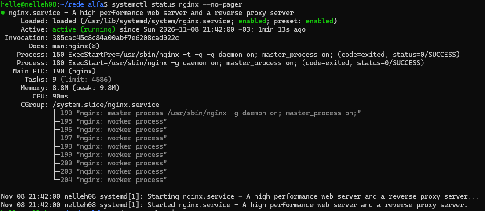
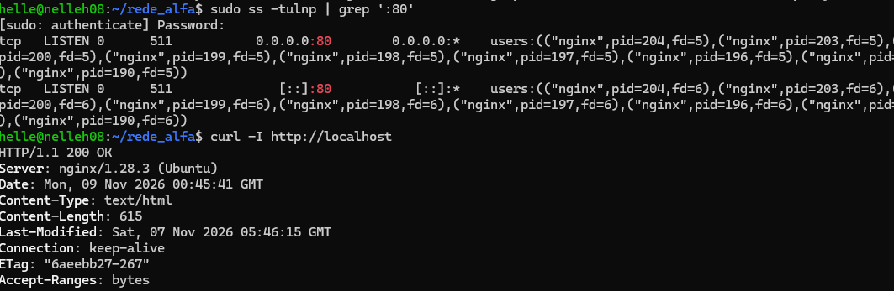
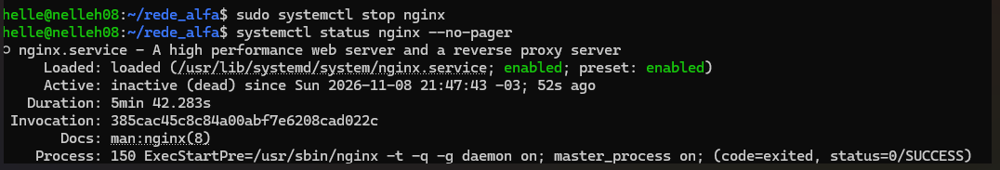
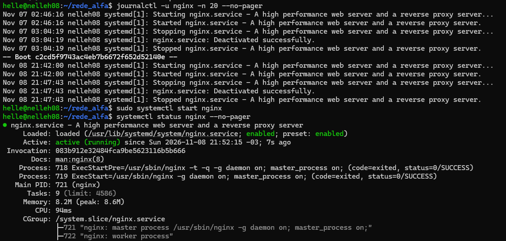
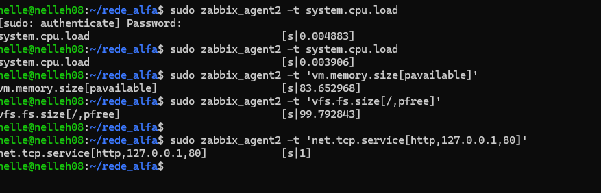

# Laboratório Linux e Monitoramento — rede_alfa

## Objetivo

Praticar administração básica de servidores Linux, diagnóstico de falhas e consulta de métricas de disponibilidade e desempenho.

Este laboratório complementa a rede corporativa simulada no Cisco Packet Tracer.

## Ambiente utilizado

- Ubuntu 26.04 LTS no WSL 2
- Nginx — servidor HTTP
- Zabbix Agent 2 — consulta local de métricas
- Terminal Linux — administração e diagnóstico

## 1. Gerenciamento do Nginx

O Nginx foi instalado para simular um serviço web que precisa permanecer disponível.

Para verificar seu funcionamento:

```bash
systemctl status nginx --no-pager
```

O estado `active (running)` indica que o serviço está em execução.



## 2. Verificação da disponibilidade HTTP

Foram realizados testes para identificar se o Nginx estava escutando na porta 80 e respondendo a requisições HTTP.

```bash
sudo ss -tulnp | grep ':80'
curl -I http://localhost
```

O resultado `HTTP/1.1 200 OK` confirmou que o servidor respondeu corretamente à requisição local.



## 3. Simulação de incidente

Foi realizada uma interrupção controlada do Nginx para praticar diagnóstico e recuperação de serviços.

Para interromper o serviço:

```bash
sudo systemctl stop nginx
```

A consulta ao estado do serviço apresentou `inactive (dead)`.



Também foram consultados os registros do serviço:

```bash
journalctl -u nginx -n 20 --no-pager
```

Após a investigação, o serviço foi restaurado:

```bash
sudo systemctl start nginx
```

A recuperação foi validada pelo retorno ao estado `active (running)`.



## 4. Consulta de métricas com Zabbix Agent 2

O Zabbix Agent 2 foi instalado para realizar consultas locais de métricas do Ubuntu.

**Carga do processador:**

```bash
sudo zabbix_agent2 -t system.cpu.load
```

**Memória disponível:**

```bash
sudo zabbix_agent2 -t 'vm.memory.size[pavailable]'
```

**Espaço livre no disco:**

```bash
sudo zabbix_agent2 -t 'vfs.fs.size[/,pfree]'
```

**Disponibilidade HTTP:**

```bash
sudo zabbix_agent2 -t 'net.tcp.service[http,127.0.0.1,80]'
```

Na verificação HTTP, o valor `1` indica que o serviço respondeu, enquanto `0` indica falha na verificação.



## 5. Aprendizados

Com este laboratório, pratiquei:

- Gerenciamento de serviços Linux com `systemctl`.
- Identificação de portas de rede com `ss`.
- Testes de disponibilidade HTTP com `curl`.
- Consulta de logs com `journalctl`.
- Diagnóstico e recuperação de indisponibilidade de serviços.
- Consulta de métricas com Zabbix Agent 2.

## Limitações do laboratório

O ambiente Ubuntu é executado localmente no WSL 2 e ainda não está integrado à topologia do Cisco Packet Tracer.

O Zabbix Agent 2 foi utilizado para testes locais. Ainda não foram configurados dashboards, coleta contínua pelo Zabbix Server ou alertas automáticos.
